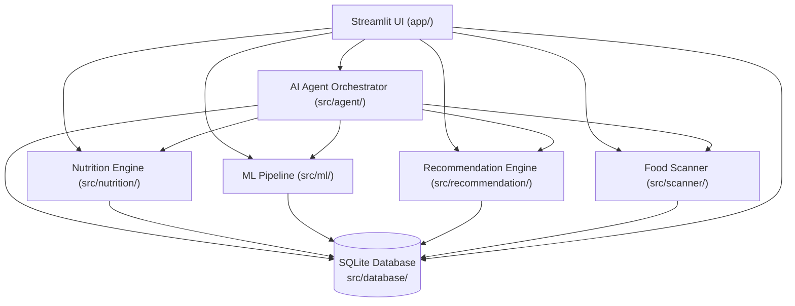
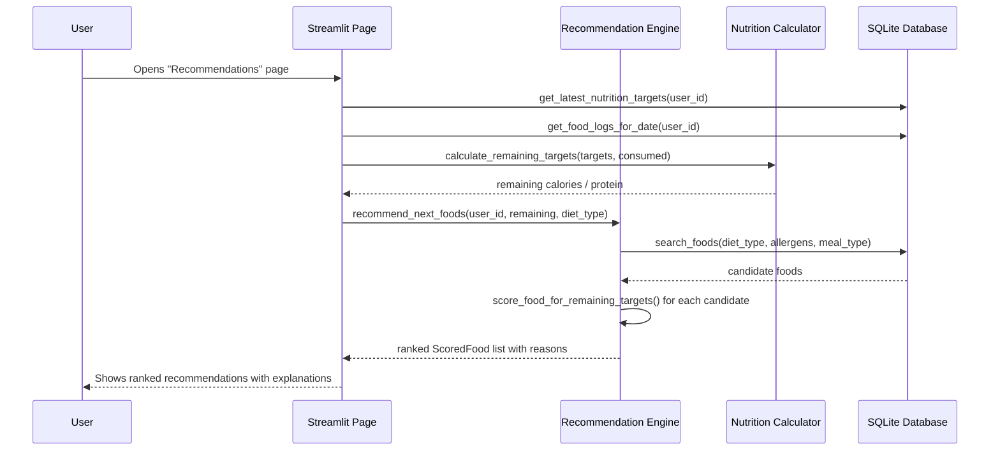
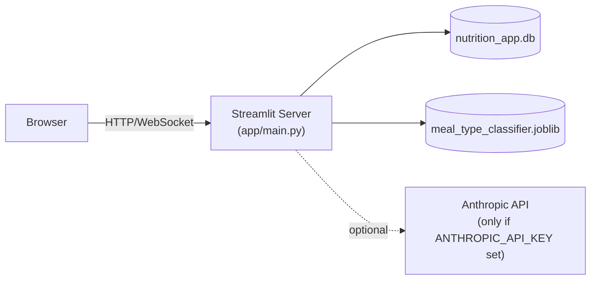

# System Architecture

## 1. High-level module diagram

Every arrow into the database goes through `src/database/repositories.py`
— no other module writes raw SQL. This means the storage layer (SQLite)
could be swapped for another database with changes confined to one file.

## 2. Why this architecture

- **Separation of concerns**: nutrition science, ML, recommendation logic,
  OCR, and the UI are independent Python packages under `src/`. Each can
  be tested and explained in isolation (see `tests/`).
- **Single source of truth per number**: the UI never recomputes a
  nutrition value itself — it always calls into `src/nutrition/` or reads
  a stored value from the database. This prevents the classic bug of the
  same number being calculated two different ways on two different pages.
- **The agent is a thin orchestrator, not a calculator**: `src/agent/`
  contains no nutrition math. It only calls functions in `src/agent/tools.py`,
  which themselves call the same modules the UI uses.

## 3. Request flow example — "What should I eat next?"

## 4. Deployment view

This is a single-process application: one Python interpreter runs the
Streamlit server, which reads/writes one local SQLite file and loads one
locally-trained model file. There is no separate backend service, no
container orchestration, and no message queue — appropriate for a
student project that must remain fully understandable and runnable on a
laptop (see Section 37 of the original project brief: no
over-engineering).

