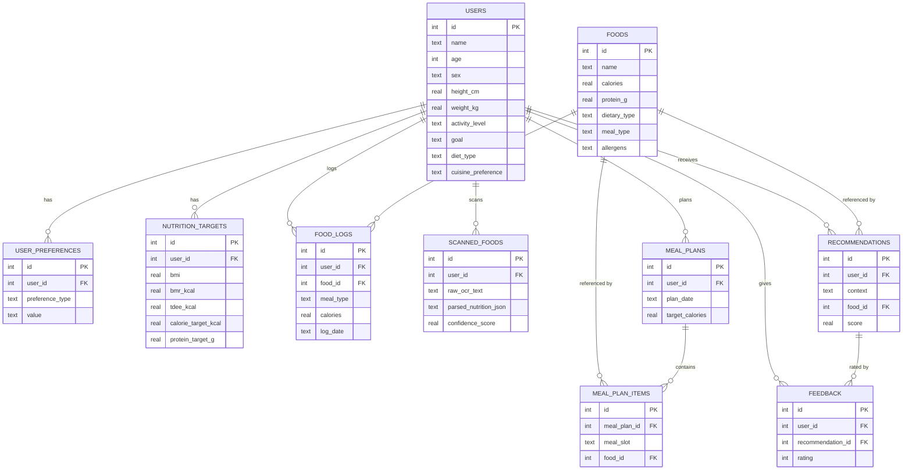

# Database Schema

Full SQL is in `src/database/schema.sql`. Entity-relationship overview:

## Design notes

- **SQLite** was chosen deliberately (Section 22/23 of the original brief):
  it needs no separate server process, ships with Python's standard
  library, and is more than sufficient for a single-user/small-team
  academic demo.
- **Snapshotting in `food_logs`**: nutrition values are copied into the log
  row at logging time (rather than only storing a `food_id` and joining
  live), so a later edit to a food's nutrition data never silently rewrites
  a user's historical log.
- **`ON DELETE CASCADE`** on user-owned tables means removing a user
  profile cleanly removes their preferences/logs/plans — there is no
  orphaned data.
- **Indexes** exist on the columns actually queried by filters in
  `repositories.py` (`meal_type`, `dietary_type`, `(user_id, log_date)`,
  etc.) to keep lookups fast even as the food database or a user's history
  grows.
